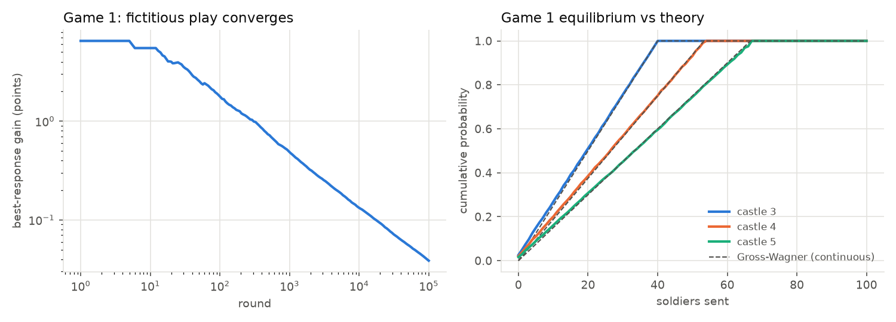
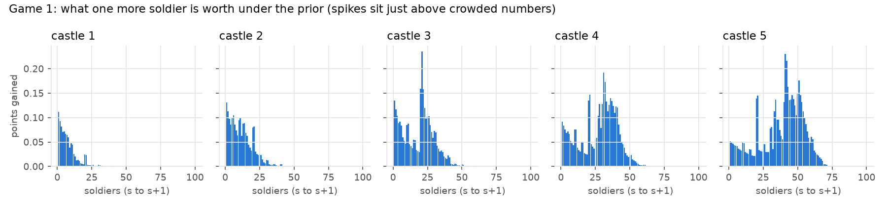

# castle_game

Choosing allocations for two castle (Colonel Blotto) games by modeling who the other
applicants are, not by solving the game in a vacuum. I put an explicit prior over what the
field looks like, simulate every world that prior allows, and pick the allocation that holds
up best across them.

## 1. Rules

100 soldiers, five castles worth 1, 2, 3, 4, 5 points (15 in total). An allocation is five
non-negative integers summing to 100.

- **Game 1 (head to head).** My allocation plays every other applicant's. Per castle, more
  soldiers takes its points and a tie splits them. Score = average castle points per matchup.
- **Game 2 (four-way).** Random groups of four; per castle the most soldiers takes it (ties
  split). Players are ranked by castle points and paid 9 / 4 / 2 / 0, with tied players
  splitting the payouts of the places they share. Score = average payout over reshuffles.

## 2. Structural facts, with evidence

**Fact 1: Game 1 is separable.** Against a field, sending `s` soldiers to castle `i` is worth
`w[i,s] = v_i * (P(opponent sends < s) + 0.5 * P(opponent sends s))`, and an allocation
scores `sum_i w[i, a_i]`. Only each castle's marginal distribution in the field matters. So:

- The exact best response to any field is a knapsack DP over 5 castles x 101 soldier counts
  (0.2 ms). The tests check it against brute force on small boards and against exhaustive
  search over all 4,598,126 legal allocations on the real board.
- Swapping the DP's `max` for `log-sum-exp` gives *exact* softmax sampling over all 4.6M
  allocations, which is how every noisy player in this repo is drawn.
- Even the prior-weighted score is separable, so the Bayes-optimal allocation is exact too,
  and exhaustive search over all allocations in all 180 worlds takes about 10 seconds.

**Fact 2: Game 1 is a symmetric constant-sum game.** Every matchup's two scores sum to 15
(tested), so the value is 7.5 and fictitious play must converge (Robinson 1951). It does:
exploitability falls as about `1/sqrt(rounds)`, to 0.039 points after 100,000 rounds. The
equilibrium also matches the known continuous solution (Gross and Wagner 1950: castle `i`
gets soldiers uniform on `[0, 2*100*v_i/15]`) to within 0.05 in CDF, with the same supports
(13 / 27 / 41 / 54 / 68 vs 13.3 / 26.7 / 40 / 53.3 / 66.7). Its mean allocation is
6-13-20-27-34: proportional to value.



**Fact 3: more than 7.5 points wins Game 2 outright.** Castle points always total 15, so a
player above 7.5 cannot be caught. The handoff's "8 or more" is the integer version of this.
Exactly 7.5 is *not* enough: `test_exactly_half_the_points_can_still_tie` builds a group where
two players tie for 1st on 7.5 each. The minimal castle sets worth 8 or more are
{5,3}, {5,4}, {5,2,1}, {4,3,1} and {4,3,2} (tested).

**Fact 4: integers create focal points.** Under the prior, the value of one more soldier
spikes just above round numbers, because a crowd sits exactly on them and one soldier
turns a tie into a win.



## 3. Player types and worlds

- **Level 0 (habits).** The "focal" flavor is a mix: 15% equal split, 15% proportional
  (7-13-20-27-33), 45% round-number splits tilted toward the big castles, 15% "stack the 5"
  (40/50/60 on castle 5) and 10% uniform random. The "random" flavor is the textbook
  uniform-over-allocations level 0.
- **Cognitive hierarchy (Camerer, Ho and Chong 2004).** Thinking levels are Poisson(tau).
  Level k noisily best-responds to levels 0..k-1 in their Poisson proportions. tau is the
  "how smart is the field" knob.
- **Equilibrium players** sample the mixed equilibrium (fictitious play in both games).
- **Meta exploiters** noisily best-respond to the actual crowd of their world, which is what
  this repo does. They punish naive play and are themselves a cluster that can be punished.
- **Noise.** Every strategic player plays a softmax ("logit") best response. Game 1: exact
  over all 4.6M allocations, lambda = 8 (low) or 3 (high) per point. Game 2: over the plans
  the search considered, lambda = 4 or 1 per payout point. These cost a strategic player
  facing the round-number crowd about 3% and 11-12% of the best achievable score
  (`results/noise_calibration.csv`).

In Game 2 there is no DP: the ranking couples castles. A best response is found by scoring
DP-built "sweep" plans (one per castle subset, each maximizing the chance of winning every
castle in the subset against the max of three opponents) by simulation, then polishing the
best by local search (moves of 1-5 soldiers).

A **world** is one setting of: tau in {0.5, 1, 1.5, 2, 3}, equilibrium share in {0, 0.1, 0.25},
exploiter share in {0, 0.1, 0.25}, level-0 flavor, and noise. That is 180 worlds.

## 4. The prior over the field

Axes are treated as independent. Every weight and its reason lives in `PRIOR` in
`experiments.py` (and `results/prior.csv`); edit and rerun.

| Axis | Value: weight | Reason |
|---|---|---|
| tau | 0.5: 0.15 | Optional 3-minute question: many applicants answer on autopilot. |
| | 1.0: 0.30 | Most who think at all stop after one step: beat the obvious split. |
| | 1.5: 0.30 | Typical lab estimate; a technical pool should reach it. |
| | 2.0: 0.15 | Sequoia / OpenAI / Citadel applicants skew quantitative and competitive. |
| | 3.0: 0.10 | Priority registration draws a motivated subset that thinks several steps ahead. |
| equilibrium share | 0: 0.40 | Few people derive or recall the Blotto equilibrium in 3 minutes. |
| | 0.1: 0.45 | Some quant applicants know it and use it as a safe default. |
| | 0.25: 0.15 | A pool selected for game theory could hold many. |
| exploiter share | 0: 0.35 | Modeling the crowd takes far more than 3 minutes. |
| | 0.1: 0.45 | Top scores earn priority registration, so a motivated minority will. |
| | 0.25: 0.20 | Stress case: a pool full of people doing this analysis. |
| level 0 | focal: 0.80 | People pile onto round numbers and simple shapes. |
| | random: 0.20 | Textbook assumption, kept as a stress test. |
| noise | low: 0.40 | Players who check their arithmetic. |
| | high: 0.60 | Three minutes, no computer: roughly, not exactly, right. |

The prior mean tau is about 1.4: the field mostly sits at levels 0-2.

## 5. Results

### Game 1 (exact: no sampling error in the scoring)

Top candidates from `results/game1_candidates.csv`. Regret is the gap to the exact best
allocation for that world.

| Candidate | Allocation | Prior score | Worst world | Prior regret | Max regret |
|---|---|---|---|---|---|
| Bayes (best prior score, exhaustive) | 3-11-27-3-56 | **8.710** | 7.216 | **0.292** | 2.385 |
| Concede 5, focal+1 | 7-21-31-41-0 | 8.619 | 7.599 | 0.383 | 1.619 |
| Concede 5 | 10-20-30-40-0 | 8.493 | 7.540 | 0.509 | 1.647 |
| Minimax regret (exhaustive) | 5-17-27-43-8 | 8.482 | 7.791 | 0.520 | **1.189** |
| Maximin (exhaustive) | 0-15-27-45-13 | 8.227 | **7.911** | 0.775 | 1.515 |
| Proportional | 7-13-20-27-33 | 6.688 | 5.509 | | |
| Equal split | 20-20-20-20-20 | 6.202 | 5.177 | | |

All four leaders have the same worst world: tau = 3 with 25% equilibrium players and 25%
exploiters, the smartest field on the grid.

**Crossovers** (`results/game1_crossover_points.csv`, tau sweep in steps of 0.125 with the other
axes averaged by the prior):

| tau range | Best candidate |
|---|---|
| below 0.76 | deep cognitive-hierarchy best responses (e.g. 3-11-2-38-46) |
| **0.76 to 2.05** | **Bayes 3-11-27-3-56** |
| 2.05 to 2.39 | concede 5, focal+1 (7-21-31-41-0) |
| above 2.39 | minimax regret (5-17-27-43-8) |


The Bayes pick tracks the best possible allocation closely from tau 1.1 to 1.9, then falls
off steeply. Above tau 2 the field itself plays strategically on castle 5, and stacking it
stops paying.

**Testing "aim one level above the field, not three"** (`results/game1_levels.csv`, levels
built at tau = 1.5):

| Level | CH best response | prior score | level-k chain | prior score |
|---|---|---|---|---|
| 1 | 1-6-21-31-41 | 7.32 | 1-6-21-31-41 | 7.32 |
| 2 | 2-2-22-32-42 | 7.57 | 4-0-22-32-42 | 7.48 |
| 3 | 1-0-23-33-43 | 7.65 | 0-1-23-33-43 | 7.67 |
| 4 | 3-16-1-36-44 | 7.94 | 20-2-0-34-44 | **6.95** |
| 6 | 3-11-2-38-46 | 8.23 | 12-4-2-36-46 | 7.83 |

The principle is half right. Overshooting is real: the level-k chain, where each level beats
only the level below it, drops a full 0.7 points from level 3 to level 4. But "one level above
the mode" (level 2, 7.57) gives up 1.1 points against the Bayes pick. The field is a mixture,
and the best move is to respond to the whole mixture, not to one imagined opponent.

### Game 2 (simulated: 20,000 groups per candidate per world, common random numbers)

From `results/game2_candidates.csv`. The CI is the 95% interval on the prior score. The gap
CI is the paired 95% interval on the difference from the leader, which is much tighter
because every candidate faces the same groups.

| Candidate | Allocation | Prior payout (+-95%) | Gap to leader | P(outright 1st) | Worst world | Max regret |
|---|---|---|---|---|---|---|
| Expected points vs 3 opponents (DP) | 1-29-1-1-68 | **6.553 +- 0.004** | 0 | 0.47 | 4.43 | 1.70 |
| Sweep {4,3}, locally searched | 0-0-41-59-0 | 6.533 +- 0.004 | 0.019 +- 0.006 | 0.53 | **5.00** | **1.56** |
| Sweep {5,3}, locally searched | 2-2-27-1-68 | 6.416 +- 0.004 | 0.137 +- 0.003 | 0.47 | 4.67 | 1.46 |
| Sweep {4,5} (an 8-point set) | 0-0-0-33-67 | 6.094 | 0.458 | 0.43 | 4.38 | 1.96 |
| Game 1's Bayes pick | 3-11-27-3-56 | 2.761 | 3.79 | 0.15 | | |
| Equal split | 20x5 | 2.285 | 4.27 | 0.09 | | |

The random-share baseline is 3.75, so Game 1's best allocation does *worse than random* in
Game 2.

The two leaders differ in how they handle exploiters. Their prior payout by exploiter share:

| Exploiter share | 1-29-1-1-68 | 0-0-41-59-0 |
|---|---|---|
| 0 | 6.59 | 6.68 |
| 0.10 | 6.55 | 6.52 |
| 0.25 | 6.50 | 6.31 |

**Testing the 8-point family (fact 3).** It is good but not best. Sweeping {5,3} or {4,5}
guarantees 1st when it works, but it costs too many soldiers to work often against a field
that also stacks castle 5. The leaders sweep **7-point** pairs ({5,2} and {4,3}). With 7 points
banked, the other three players split the remaining 8 among themselves, so 7 is usually
enough for 1st, and much cheaper to secure.

**Game 2 equilibrium.** Replicator dynamics on a fixed pool of about 200 plans did not
converge: a best response still earned 3.74 above the 3.75 baseline. The mix piled onto a
few plans with exact soldier counts, which one extra soldier beats. Fictitious play with the
search-based best response did converge: exploitability fell 5.25 -> 0.99 -> 0.47 -> 0.38
over 10 / 175 / 733 / 1500 rounds (`results/game2_equilibrium_trace.csv`). The search oracle
is approximate, so these are lower bounds.

## 6. Final picks

**Game 1: 3-11-27-3-56.** It has the best prior score of all 4.6M allocations (8.71), the
lowest prior regret (0.29), and it is the best candidate for tau from 0.76 to 2.05, which
holds most of the prior's mass. The logic: the thinking part of the field piles onto castle 4
with 31-38 soldiers (every level-k best response does), so castle 4 is the most expensive
point on the board. Giving it up funds 27 on castle 3 (above the 21-26 cluster) and 56 on
castle 5 (above the 40-50 stacks).

The cost is fragility: max regret 2.39, the worst on the shortlist. If I believed the field
were deeper than tau of about 2, I would switch to **7-21-31-41-0** (0.09 lower prior score,
max regret 1.62, best for tau 2.05-2.39). The crossover is the decision: it is the tau where
these two trade places.

**Game 2: 1-29-1-1-68.** It has the best prior payout (6.553 +- 0.004), and its lead over the
runner-up is statistically clear (0.019 +- 0.006, paired). It barely moves with the share of
exploiters (6.59 -> 6.50), while the runner-up 0-0-41-59-0 drops to 6.31. The runner-up has
the better worst case (5.00 vs 4.43). If I feared a field full of equilibrium players and
exploiters at tau = 2, it would be the hedge.

## 7. Did the strategy change between games?

Completely. Game 1 rewards the *average* over matchups, so it pays to win many cheap castles
by small margins: 4 of 5 castles contested. Game 2 pays 9 / 4 / 2 / 0, so winning matters far
more than placing, and beating the *max of three* opponents on a castle costs far more than
beating one. That pushes toward concentration: two castles, decisively. Game 1's pick scores
2.76 in Game 2, below the 3.75 a random seat earns. Game 2's pick would also be poor in
Game 1, where it gives away three castles to almost everyone.

## 8. Limitations, and how to reproduce

- **The prior is mine.** The Game 1 pick flips past tau of about 2.05; anyone who believes the
  field is deeper should take 7-21-31-41-0. The crossover table says exactly where.
- **Level 0 is modeled, not measured.** The "focal" mix (80% of the prior) drives the castle-4
  concession. I have no real data from this contest. The Riddler Blotto contests are the
  closest public data, but they use 10 castles.
- **Game 2 types assume strategic players re-optimize for Game 2.** In reality many will paste
  their Game 1 answer. That would make the field *less* concentrated, which should favor the
  concentrated picks even more, but it is untested.
- **Game 2 best responses are approximate** (DP-seeded plans plus local search), so Game 2
  regrets are against the best allocation found, not the true optimum.
- **Axes are independent in the prior.** A smart field probably also has more equilibrium
  players and exploiters; correlated priors would push toward the hedges.
- Noise is calibrated against one field (the round-number crowd) and held fixed elsewhere.

Reproduce (Python 3.12, about 2.5 minutes on an M-series Mac):

```
python -m venv .venv && .venv/bin/pip install -r requirements.txt
.venv/bin/python -m pytest -q          # 59 tests, about 10 s
.venv/bin/python experiments.py        # writes results/ (CSVs and 3 plots)
.venv/bin/python experiments.py --quick         # 25 s smoke test
.venv/bin/python experiments.py --plots-only    # redraw plots from results/
```

Seeds are fixed, so a rerun reproduces the same numbers.

## 9. Draft form answer (to rewrite in my own words)

> Game 1: 3-11-27-3-56. Game 2: 1-29-1-1-68. I modeled the field as a mix of habit players
> (round numbers, equal splits), cognitive-hierarchy thinkers, equilibrium players and
> exploiters, weighted 180 such worlds by a prior, and searched all 4.6M allocations. In
> Game 1 the thinking crowd overpays for castle 4, so I concede it and win 3 and 5 just above
> the crowded numbers. That stays best unless the field's average depth exceeds about two
> levels. Game 2 pays for winning, not placing, and you must beat the max of three, so I
> concentrate: take castles 5 and 2 decisively. Seven points usually wins, and it costs far
> less than the eight that guarantee it.
