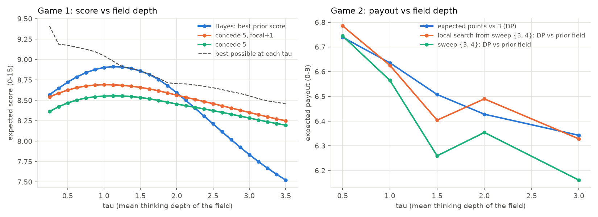

# castle_game

My answer to the castle allocation question (a Colonel Blotto variant). Instead of looking for one
"optimal" allocation, I tried to model who I'm actually playing against, simulated a bunch of
possible fields, and picked the allocation that holds up across them.

## The rules

100 soldiers across five castles worth 1-5 points (15 total).

- **Game 1:** heads up against every other applicant. More soldiers takes the castle, ties split it.
  Score is your average points per matchup.
- **Game 2:** random groups of four. Most soldiers takes each castle, then everyone is ranked by
  points and paid 9 / 4 / 2 / 0 (ties split the payouts).

## My picks

- **Game 1: 8-17-30-44-1**
- **Game 2: 18-8-2-2-70**

## How I got there

A few things about the game made this tractable:

- Game 1 only depends on how many soldiers the field sends to each castle, so the best response to
  any field can be computed exactly, and I could check every one of the 4.6M legal allocations.
- Game 1 is zero-sum, so its equilibrium can be found with fictitious play. Mine matches the known
  textbook solution (soldiers on each castle spread evenly up to about twice its fair share).
- In Game 2, anything over 7.5 points guarantees 1st, since the other three share the rest.
- Round numbers matter. People pile onto 20, 30, 40, so one extra soldier above a crowded number
  flips a lot of castles.

Then I modeled the other players as a mix of:

- **habit players** (equal split, round numbers, "stack the 5")
- **level-k thinkers** (level 1 beats the habit players, level 2 beats level 1, and so on)
- **equilibrium players** who know the theory
- **crowd-modelers** who do roughly what I'm doing here

Each combination of how deep people think, how many equilibrium players and crowd-modelers there
are, and how sloppy everyone is gives one "world". That's 180 worlds. I weighted them with a prior.
Since the sponsors are Sequoia, OpenAI and Citadel and top scores get priority registration, I
assumed a sharp field: most people thinking 2-3 levels deep, a few going 4+. The weights and my
reason for each one are in `PRIORS` in `experiments.py`.

## What came out

**Game 1:** the smart crowd fights over castle 5, so it's overpriced. Conceding it and winning the
other four scored best out of all 4.6M allocations (8.69 out of 15). It stays the best option at
every depth from about one level up.

The obvious question is what happens if I'm wrong and the field is shallower. So I also ran a more
skeptical prior, where most people think about one level deep. That flips the answer to stacking
castle 5 (3-11-27-3-56). But the bet is lopsided:

| | Field is sharp | Field is shallow |
|---|---|---|
| My pick (8-17-30-44-1) | best | lose 0.08 points |
| Shallow pick (3-11-27-3-56) | lose 0.60 points | best |

So my pick is the safer one either way.



**Game 2:** winning is what pays, and you have to beat the best of three opponents on a castle,
not just one. So the answer is to concentrate: 70 on castle 5, which beats the field most of the
time, and scraps spread around to grab castles other people abandoned. It wins outright about 47% of
the time and averages 6.57 out of 9 (random would be 3.75). Committing to a set worth 8 points
(like castles 5 and 3) actually did worse, because it costs too many soldiers to pull off.

My Game 1 pick only scores 3.92 in Game 2, barely above random, so the strategy really does have to
change between games.

## Caveats

- The prior is my judgment call. The skeptical version is in `results/baseline/` if you want to
  compare.
- I don't have real data on how people play this, so the habit players are modeled, not measured.
- In Game 2 I assumed thinking players re-optimize. A lot of people will probably just paste their
  Game 1 answer.
- Game 2 has no exact solution, so its best responses come from search and are approximate.

## Run it

```
python -m venv .venv && .venv/bin/pip install -r requirements.txt
.venv/bin/python -m pytest -q                      # tests, ~10 s
.venv/bin/python experiments.py                    # sharp prior -> results/ (~3 min)
.venv/bin/python experiments.py --prior baseline   # skeptical prior -> results/baseline/
```

Seeds are fixed, so the numbers reproduce exactly. Full tables are in `results/`.

## Form answer

> This problem is a classic take on the Colonel Blotto game, same idea of allocating soldiers to
> castles, but primarily in a heads up variant. I made the assumption that people I would be
> competing against are sharp students, just based on the nature of the competition itself, and
> the sponsors coming. Therefore, it would be naive to stick with only one level of thinking, and
> most would go two to three layers deep in thinking. I then weighted 180 worlds based on a prior
> and checked different thinking level allocations. Game 1, smart players fight over castle five,
> as it has a high point yield in most outcomes. I made the decision to concede this castle and win
> the other 4, which my simulations show over different depths. Game 2 pays you for winning, so an
> allocation of all to 5 and some to castle 1 secures 6 points, which beats castle 3 and 4
> allocations on average. Fun problem!
